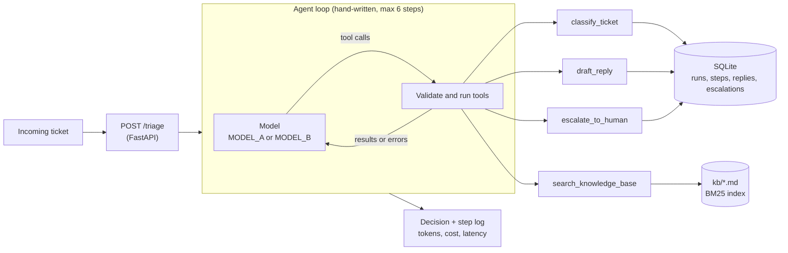

# Support Ticket Triage Agent

Support teams lose most of their first-response time to tickets sitting in a queue, waiting for someone to read them, work out what they are about and find the right help article. This agent does that first pass in seconds: it reads each incoming ticket, classifies it, searches the help center, and either drafts a grounded reply for an agent to approve or escalates to a human with a reason. Routine tickets get a ready-to-send answer the moment they arrive, risky ones (account takeovers, data loss, legal threats) go straight to a person, and every decision is logged step by step so the team can audit it. The included eval measures accuracy, cost per ticket and latency on two models, so you can pick the cheapest model that is good enough.

## How it works



- **The model chooses the tools and their order.** The loop in [app/agent.py](app/agent.py) only asks the model, runs what it asked for, and feeds the results back. There is no framework.
- **Four tools** ([app/tools.py](app/tools.py)): `classify_ticket`, `search_knowledge_base`, `draft_reply`, `escalate_to_human`.
- **Knowledge base search** is BM25 written from scratch over 10 FAQ files ([app/kb.py](app/kb.py)).
- **Everything is stored in SQLite** ([app/db.py](app/db.py)): each run, each step (thought, tool, arguments, result), replies and escalations.

Guardrails:

- The loop stops after 6 model calls (`MAX_STEPS`).
- Bad tool arguments, invalid JSON, unknown tools and tool crashes are returned to the model as errors, so it can correct itself. They never crash the loop.
- A ticket can never end with no outcome. If the agent drafts no reply and escalates nothing (step limit, model refusal, cut-off output), the ticket is escalated automatically.
- Replies are drafts for a human to send. Nothing is sent to a customer.
- Ticket text is treated as data. The agent can only act on the ticket it was given.

## Setup

Requires Python 3.11+.

```bash
pip install -r requirements.txt
cp .env.example .env        # then put your ANTHROPIC_API_KEY in .env
./demo.sh
```

`demo.sh` runs three tickets (a routine refund question, a password reset written in Spanish, and an account takeover) and prints every agent step. It takes about 30 seconds and saves the transcript to `results/demo-output.txt`.

## Usage

```bash
# Any tickets from sample_tickets.json, on model A or B
python -m app.cli --tickets T-001 T-012 --model B

# API
uvicorn app.main:app
curl -X POST localhost:8000/triage -H "content-type: application/json" \
  -d '{"subject": "Refund request", "body": "I upgraded 10 days ago and want my money back."}'

# Compare MODEL_A and MODEL_B on all 20 tickets
python eval.py

# Tests (offline, no API key needed)
pytest
```

`POST /triage` accepts `subject`, `body`, and optionally `ticket_id`, `customer` and `model` (`"A"`, `"B"` or a model id). It returns the classification, the drafted reply or escalation reason, every step, token counts, cost and latency.

## Sample output

<!-- sample:start -->
_Not captured yet. Run `./demo.sh` and paste `results/demo-output.txt` here._
<!-- sample:end -->

Each step is printed like this: the agent's thought, then each tool call with its arguments and result, then the outcome with model calls, tool calls, tokens, cost and time.

## Evaluation

`python eval.py` runs all 20 sample tickets through both models and compares each result with the ticket's labeled `expected` field. It writes [results/report.md](results/report.md), which also has a per-ticket table, and refreshes the table below.

<!-- eval:start -->
_Not run yet. Run `python eval.py` to fill in this table._
<!-- eval:end -->

- **Category accuracy**: the agent's category matches the label.
- **Escalation accuracy**: the agent escalated exactly the tickets labeled as needing a human.
- **Cost** uses the price per million tokens in [app/config.py](app/config.py), or `MODEL_A_PRICE` / `MODEL_B_PRICE` in `.env`.

## Configuration

All settings are in `.env` (see [.env.example](.env.example)).

| Variable | Default | Meaning |
|---|---|---|
| `MODEL_A`, `MODEL_B` | `claude-fable-5-2`, `claude-haiku-5-5` | The two models. Swap them without touching code. |
| `MODEL_A_PRICE`, `MODEL_B_PRICE` | built-in table | `input,output` in USD per million tokens, for models not in the table. |
| `MAX_STEPS` | `6` | Model calls per ticket. |
| `MAX_TOKENS` | `8000` | Output cap per model call. |
| `THINKING_DISPLAY` | `summarized` | Shows the model's reasoning summary as the step's thought. Use `off` for older models. |
| `DB_PATH` | `triage.db` | SQLite file. |

## Project layout

```
app/
  agent.py     the agent loop, step log, safety net
  tools.py     the four tools: schemas, validation, handlers
  kb.py        BM25 search over kb/
  db.py        SQLite schema and queries
  llm.py       thin wrapper over the Anthropic SDK
  config.py    settings and prices
  main.py      FastAPI app (POST /triage)
  cli.py       terminal runner used by demo.sh
kb/            10 FAQ articles
tests/         54 tests; the model is replaced by a scripted fake
eval.py        two-model comparison
sample_tickets.json   20 labeled tickets
```
