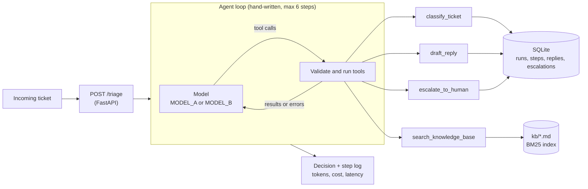

# Support Ticket Triage Agent

Support teams lose most of their first-response time to tickets sitting in a queue, waiting for someone to read them, work out what they are about and find the right help article. This agent does that first pass in seconds: it reads each incoming ticket, classifies it, searches the help center, and either drafts a grounded reply for an agent to approve or escalates to a human with a reason. Routine tickets get a ready-to-send answer the moment they arrive, risky ones (account takeovers, data loss, legal threats) go straight to a person, and every decision is logged step by step so the team can audit it. The included eval measures accuracy, cost per ticket and latency on two models, so you can pick the cheapest model that is good enough.

## How it works



- **The model chooses the tools and their order.** The loop in [app/agent.py](app/agent.py) only asks the model, runs what it asked for, and feeds the results back. There is no framework.
- **Four tools** ([app/tools.py](app/tools.py)): `classify_ticket`, `search_knowledge_base`, `draft_reply`, `escalate_to_human`.
- **Knowledge base search** is BM25 written from scratch over 10 FAQ files ([app/kb.py](app/kb.py)).
- **Everything is stored in SQLite** ([app/db.py](app/db.py)): each run, each step (thought, tool, arguments, result), replies and escalations.

Guardrails:

- The loop stops after 6 model calls (`MAX_STEPS`).
- Bad tool arguments, invalid JSON, unknown tools and tool crashes are returned to the model as errors, so it can correct itself. They never crash the loop.
- A ticket can never end with no outcome. If the agent drafts no reply and escalates nothing (step limit, model refusal, cut-off output), the ticket is escalated automatically.
- Replies are drafts for a human to send. Nothing is sent to a customer.
- Ticket text is treated as data. The agent can only act on the ticket it was given.

## Setup

Requires Python 3.11+.

```bash
pip install -r requirements.txt
cp .env.example .env        # then put your ANTHROPIC_API_KEY in .env
./demo.sh
```

`demo.sh` runs three tickets (a routine refund question, a password reset written in Spanish, and an account takeover) and prints every agent step. It takes under a minute and saves the transcript to `results/demo-output.txt`.

## Usage

```bash
# Any tickets from sample_tickets.json, on model A or B
python -m app.cli --tickets T-001 T-012 --model B

# API
uvicorn app.main:app
curl -X POST localhost:8000/triage -H "content-type: application/json" \
  -d '{"subject": "Refund request", "body": "I upgraded 10 days ago and want my money back."}'

# Compare MODEL_A and MODEL_B on all 20 tickets
python eval.py

# Tests (offline, no API key needed)
pytest
```

`POST /triage` accepts `subject`, `body`, and optionally `ticket_id`, `customer` and `model` (`"A"`, `"B"` or a model id). It returns the classification, the drafted reply or escalation reason, every step, token counts, cost and latency.

## Sample output

<!-- sample:start -->
The third ticket of `./demo.sh` on `claude-fable-5-2`, unedited. The full transcript of all three tickets is in [results/demo-output.txt](results/demo-output.txt).

```text
=== T-005 | claude-fable-5-2 ========================================
  subject: Someone else is in my account
  body:    I got an alert about a sign-in from a country I've never been to, and now my account email has
           been changed to an address I don't recognise. I can't log in any more. Our client contracts are
           in that workspace. Please lock it immediately.

  [step 1] thought: This looks like an account takeover, so I'll classify it, search the knowledge base, and
           escalate all at once since the search results will shape the draft holding reply I send
           afterward.
           I'm classifying this as an urgent account takeover, escalating it to a human right
           away, and searching the FAQ for anything that can support a holding reply.
  [step 1] tool:    classify_ticket({"category": "account", "priority": "urgent", "sentiment": "negative"})
  [step 1] result:  {"ticket_id": "T-005", "category": "account", "priority": "urgent", "sentiment": "negative"}
  [step 1] tool:    escalate_to_human({"ticket_id": "T-005", "reason": "Likely account takeover: customer reports a sign-in alert from an unfamiliar country, the account email was changed to an address he doesn't recognise, and he is locked out. He asks for the account/workspace (contains client contracts) to be locked immediately; needs identity verification, account lock and recovery by staff."})
  [step 1] result:  {"escalated": true, "escalation_id": 1, "ticket_id": "T-005"}
  [step 1] tool:    search_knowledge_base({"query": "account compromised unauthorized sign-in email changed"})
  [step 1] result:  {"query": "account compromised unauthorized sign-in email changed", "results": [{"file": "reset-password.md", "title": "Reset your password", "score": 7.714, "text": "On the sign-in page choose Forgot password and enter your account email. The reset link is va...
  [step 2] thought: The FAQ has nothing on account takeover, so I need a holding reply that doesn't promise anything
           I can't back up. A password reset won't help here since the email on the account has changed.
           I'll keep the reply honest and avoid committing to any lock or timeline.
           The FAQ has no article
           on compromised accounts, so I'm drafting a short holding reply that makes no promises beyond the
           escalation that has already happened.
  [step 2] tool:    draft_reply({"ticket_id": "T-005", "reply_text": "Hi Marcus,\n\nThank you for reporting this so quickly. We're treating it as a possible unauthorised access to your account, and your ticket has been flagged as urgent and passed to a member of our support team who can investigate and take action on the account directly.\n\nBecause the email address on the account has been changed, the self-service password reset won't work for you, so please don't rely on it. The agent handling your case will contact you at this address (marcus.lee@example.com) and will need to verify your identity before making changes to the account.\n\nPlease reply to this email if you notice anything further, such as additional sign-in alerts or messages you didn't expect.\n\nWe understand how important the contents of your workspace are, and we're sorry for the worry this is causing.\n\nBest regards,\nTasklane Support"})
  [step 2] result:  {"saved": true, "reply_id": 3, "ticket_id": "T-005"}
  [step 3] thought: T-005 is classified as an urgent account ticket with negative sentiment and escalated to a human
           as a likely account takeover; nothing has been locked yet, because only staff can do that. I
           also saved a holding reply for agent review that makes no commitment on timing or outcome, since
           the FAQ has no article on compromised accounts.
  => ESCALATED  category=account  priority=urgent  sentiment=negative
     escalation: Likely account takeover: customer reports a sign-in alert from an unfamiliar country, the
                 account email was changed to an address he doesn't recognise, and he is locked out. He asks for
                 the account/workspace (contains client contracts) to be locked immediately; needs identity
                 verification, account lock and recovery by staff.
     drafted reply:
       | Hi Marcus,

       | Thank you for reporting this so quickly. We're treating it as a possible unauthorised access to your account, and your ticket has been flagged as urgent and passed to a member of our support team who can investigate and take action on the account directly.

       | Because the email address on the account has been changed, the self-service password reset won't work for you, so please don't rely on it. The agent handling your case will contact you at this address (marcus.lee@example.com) and will need to verify your identity before making changes to the account.

       | Please reply to this email if you notice anything further, such as additional sign-in alerts or messages you didn't expect.

       | We understand how important the contents of your workspace are, and we're sorry for the worry this is causing.

       | Best regards,
       | Tasklane Support
     3 model calls, 4 tool calls, 7,204 in / 993 out tokens, cost $0.0974, 12.3s
```
<!-- sample:end -->

Each step is printed like this: the agent's thought, then each tool call with its arguments and result, then the outcome with model calls, tool calls, tokens, cost and time.

## Evaluation

`python eval.py` runs all 20 sample tickets through both models and compares each result with the ticket's labeled `expected` field. It writes [results/report.md](results/report.md), which also has a per-ticket table, and refreshes the table below.

<!-- eval:start -->
Date: 2026-11-10. Tickets: 20 from `sample_tickets.json`. Step cap: 6.

| Model | Category accuracy | Escalation accuracy | Avg tool calls | Total tokens (in / out) | Total cost | Cost per ticket | Avg latency |
|---|---|---|---|---|---|---|---|
| `claude-fable-5-2` | 100% | 95% | 3.7 | 139,330 / 18,339 | $1.8482 | $0.0924 | 12.7s |
| `claude-haiku-5-5` | 100% | 85% | 3.4 | 124,983 / 17,950 | $0.0215 | $0.0011 | 5.5s |

- `claude-fable-5-2`: $8 input / $40 output per million tokens.
- `claude-haiku-5-5`: $0.1 input / $0.5 output per million tokens.
<!-- eval:end -->

- **Category accuracy**: the agent's category matches the label.
- **Escalation accuracy**: the agent escalated exactly the tickets labeled as needing a human.
- **Cost** uses the price per million tokens in [app/config.py](app/config.py), or `MODEL_A_PRICE` / `MODEL_B_PRICE` in `.env`.

## Configuration

All settings are in `.env` (see [.env.example](.env.example)).

| Variable | Default | Meaning |
|---|---|---|
| `MODEL_A`, `MODEL_B` | `claude-fable-5-2`, `claude-haiku-5-5` | The two models. Swap them without touching code. |
| `MODEL_A_PRICE`, `MODEL_B_PRICE` | built-in table | `input,output` in USD per million tokens, for models not in the table. |
| `MAX_STEPS` | `6` | Model calls per ticket. |
| `MAX_TOKENS` | `8000` | Output cap per model call. |
| `THINKING_DISPLAY` | `summarized` | Shows the model's reasoning summary as the step's thought. Use `off` for older models. |
| `DB_PATH` | `triage.db` | SQLite file. |

## Project layout

```
app/
  agent.py     the agent loop, step log, safety net
  tools.py     the four tools: schemas, validation, handlers
  kb.py        BM25 search over kb/
  db.py        SQLite schema and queries
  llm.py       thin wrapper over the Anthropic SDK
  config.py    settings and prices
  main.py      FastAPI app (POST /triage)
  cli.py       terminal runner used by demo.sh
kb/            10 FAQ articles
tests/         54 tests; the model is replaced by a scripted fake
eval.py        two-model comparison
sample_tickets.json   20 labeled tickets
```
